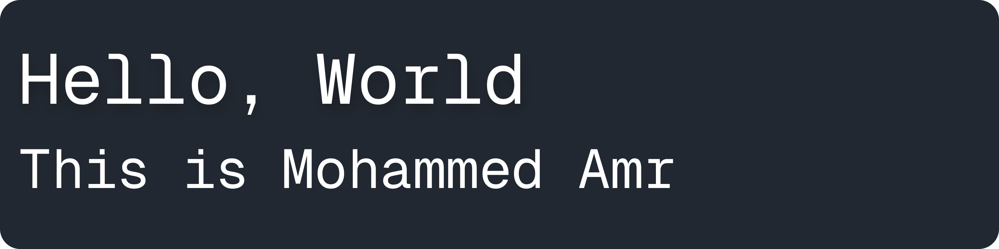

## Mohammed Amr

Frontend engineer based in Cairo, Egypt. Currently at **Vodafone Egypt**, working on the migration of the customer storefront from Angular to Next.js. I care about fast, accessible interfaces and maintainable front-end architecture.

**Background**

- Software Engineer at Vodafone Egypt · freelance web developer since 2023
- ITI (Information Technology Institute) graduate
- LLB, Faculty of Law
- Publishing open-source Deno packages at [jsr.io/@ilawy](https://jsr.io/@ilawy)
- [ilawy.dev](https://ilawy.dev)

## Stack

  

## Featured work

## GitHub stats

## Contact

<a target="_blank" href="https://linkedin.com/in/ilawy">
    ‎ ‎ 
    
    ‎ 
</a>
‎ ‎ ‎ ‎ ‎ 
<a target="_blank" href="mailto:next.mohammed.amr@gmail.com">
    ‎ ‎ 
    
    ‎ 
</a>
‎ ‎ ‎ ‎ ‎ 
<a target="_blank" href="https://ilawy.dev">
    ‎ ‎ 
    
    ‎ ‎ 
</a>

